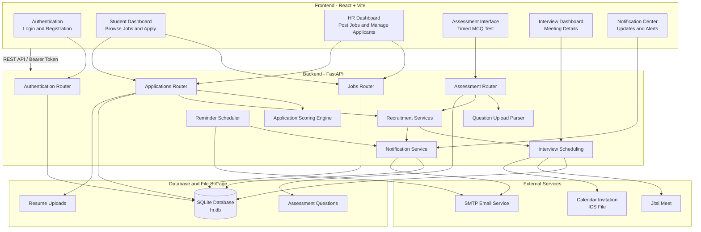
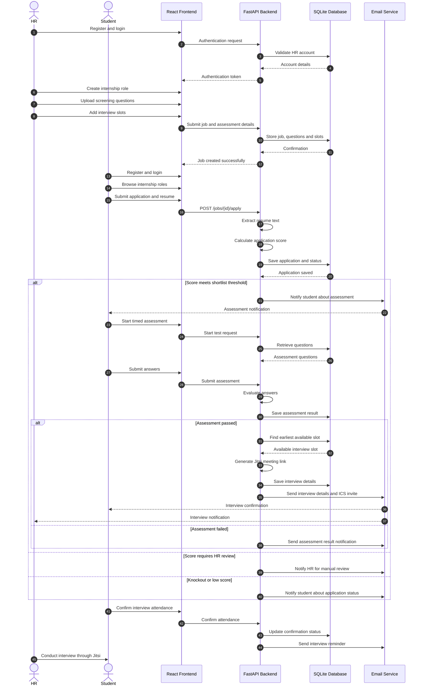
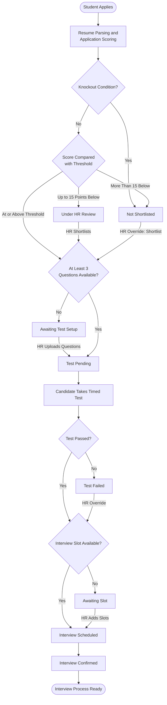
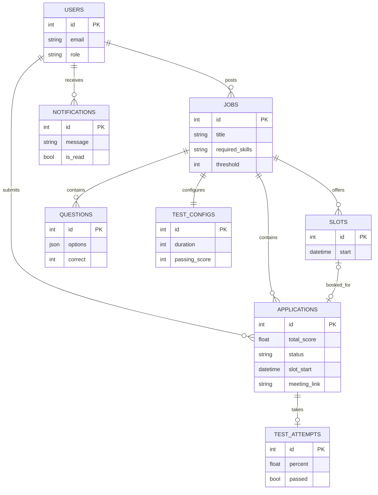

# Hr_Evaluator

An online internship hiring portal that connects students and HR teams through an automated recruitment workflow. Students can explore internship opportunities, apply with resumes, and complete screening tests. HR users can publish jobs, evaluate applications, manage assessments, and schedule interviews.

Applications receive an automated score out of 100. Shortlisted candidates complete a timed assessment, and successful candidates can be assigned an HR interview slot with a Jitsi video-call link.

---

## Table of Contents

- [Features](#features)
- [System Architecture](#system-architecture)
- [End-to-End Workflow](#end-to-end-workflow)
- [Application Status Flow](#application-status-flow)
- [Database Design](#database-design)
- [Application Scoring](#application-scoring)
- [Technology Stack](#technology-stack)
- [Project Structure](#project-structure)
- [Installation and Setup](#installation-and-setup)
- [Test Question Format](#test-question-format)
- [API Overview](#api-overview)
- [Known Limitations](#known-limitations)

---

## Features

### Student Module
- Student registration and login.
- Browse available internship opportunities.
- Apply for internships with resume uploads.
- Submit skills, college details, and screening answers.
- Optional voice input using the browser Web Speech API.
- View application scores and statuses.
- Complete timed multiple-choice assessments.
- View interview schedules and Jitsi meeting links.
- Receive in-app notifications and email updates.

### HR Module
- HR registration using a signup code.
- Create and manage internship opportunities.
- Specify required skills, location, stipend, duration, and shortlist threshold.
- View and evaluate student applications.
- Upload screening questions through PDF, TXT, or CSV files.
- Add assessment questions manually.
- Review application scores.
- Manually shortlist or reject candidates.
- Manage interview slots.
- Schedule interviews automatically for successful candidates.

### Automated Recruitment
- Resume parsing and keyword-based evaluation.
- Automatic application scoring out of 100.
- Knockout conditions for eligibility.
- Automatic shortlisting based on configurable thresholds.
- Timed online assessments.
- Server-side test evaluation.
- Automatic interview slot allocation.
- Jitsi video meeting link generation.
- Email notifications and calendar invitations.
- Interview reminders approximately one hour before the scheduled time.

---

## System Architecture

The application follows a frontend-backend architecture. React communicates with FastAPI through REST APIs. FastAPI handles authentication, application processing, scoring, assessments, scheduling, and notifications.



### Architecture Components

| Component | Responsibility |
|---|---|
| React + Vite | User interface and dashboards |
| FastAPI | Backend API and business logic |
| Authentication Router | Login, registration, and token management |
| Jobs Router | Internship posting and slot management |
| Applications Router | Application submission and decisions |
| Scoring Engine | Automated application evaluation |
| Assessment Module | Question management and test evaluation |
| Recruitment Services | Shortlisting, scheduling, and notifications |
| SQLite | Persistent application data |
| SMTP | Email communication |
| Jitsi Meet | Video interview meetings |

---

## End-to-End Workflow

This sequence diagram illustrates how HR and students interact with the platform.



---

## Application Status Flow

The following diagram explains the application evaluation and recruitment process.



---

## Database Design

The application uses SQLite for persistent storage.

The following entity relationship diagram represents the primary database entities and their relationships.



**Note:** This diagram describes the documented logical relationships. Check your SQLAlchemy models before treating every illustrated field or relationship as an exact implementation detail.

---

## Application Scoring

Each application is evaluated using a fixed rule-based scoring mechanism.

The total application score is calculated out of 100.

| Evaluation Component | Points | Evaluation Method |
|---|---:|---|
| Skill Match | 35 | Required skills found in resume receive full points; skills entered only in the skills field receive half points |
| Resume Quality | 15 | Resume length (7) and relevant keywords (8) |
| Introduction and Experience Answers | 24 | Answer length and mention of required skills |
| Hours, Stipend and Location | 14 | Positive eligibility responses |
| Commitment and NOC | 12 | Duration commitment and approval availability |
| **Total** | **100** | |

### Knockout Conditions

An application can be rejected regardless of its numerical score when:

- The candidate is not comfortable with the working hours or stipend.
- The candidate is not comfortable with the location, unless the role is remote.
- The candidate's committed duration is shorter than the internship duration.

### Shortlisting Rules

| Evaluation | Outcome |
|---|---|
| Score at or above threshold | Shortlisted |
| Up to 15 points below threshold | Under HR Review |
| More than 15 points below threshold | Not Shortlisted |
| Knockout condition | Not Shortlisted |

HR can manually override application decisions.

**Important:** The current scoring mechanism uses keyword matching and predefined rules. It is not an AI-based resume evaluation model.

---

## Technology Stack

| Layer | Technology |
|---|---|
| Frontend | React 18 |
| Build Tool | Vite |
| Programming Language | JavaScript |
| Backend | Python 3.12 |
| Backend Framework | FastAPI |
| ORM | SQLAlchemy |
| ASGI Server | Uvicorn |
| Database | SQLite |
| Resume Parsing | pypdf |
| Question Parsing | PDF, TXT and CSV |
| Voice Input | Browser Web Speech API |
| Authentication | Bearer Token |
| Email Service | SMTP |
| Video Conferencing | Jitsi Meet |
| Calendar Invitation | ICS Calendar File |

---

## Project Structure

```text
Hr_System/
│
├── backend/
│   │
│   ├── requirements.txt
│   ├── .env.example
│   ├── hr.db
│   │
│   └── app/
│       ├── main.py
│       ├── database.py
│       ├── models.py
│       ├── schemas.py
│       ├── security.py
│       ├── scoring.py
│       ├── services.py
│       ├── questions.py
│       ├── email_service.py
│       ├── qparse.py
│       │
│       └── routers/
│           ├── auth.py
│           ├── jobs.py
│           ├── applications.py
│           ├── notifications.py
│           ├── tests.py
│           └── qupload.py
│
├── frontend/
│   │
│   ├── package.json
│   ├── vite.config.js
│   ├── index.html
│   │
│   └── src/
│       ├── main.jsx
│       ├── App.jsx
│       ├── api.js
│       ├── ui.js
│       ├── styles.css
│       │
│       └── components/
│           ├── Auth.jsx
│           ├── StudentDashboard.jsx
│           ├── HrDashboard.jsx
│           ├── ApplyForm.jsx
│           ├── TestManager.jsx
│           ├── TestRunner.jsx
│           └── Notifications.jsx
│
└── README.md
```

---

## Installation and Setup

### Prerequisites

Install the following before running the application:

- Python 3.10 or later
- Node.js 18 or later
- npm
- Git (optional)

### 1. Clone the Repository

```powershell
git clone <your-repository-url>
cd Hr_System
```

### 2. Backend Setup

Open PowerShell in the project directory.

```powershell
cd backend

# Create virtual environment
python -m venv venv

# Activate virtual environment
Set-ExecutionPolicy -Scope Process Bypass
.\venv\Scripts\Activate.ps1

# Install dependencies
pip install -r requirements.txt

# Create environment configuration
Copy-Item .env.example .env

# Start FastAPI server
python -m uvicorn app.main:app --reload --port 8000
```

Backend URL:

```text
http://127.0.0.1:8000
```

API documentation:

```text
http://127.0.0.1:8000/docs
```

### 3. Frontend Setup

Open a second PowerShell terminal.

```powershell
cd C:\Users\soumy\OneDrive\Desktop\Hr_System\frontend

# Install dependencies
npm install

# Start Vite development server
npm run dev
```

Frontend URL:

```text
http://localhost:5173
```

### 4. Environment Configuration

Configure the following variables in `backend/.env`.

```env
HR_SIGNUP_CODE=your_secure_signup_code

SMTP_HOST=
SMTP_PORT=
SMTP_USER=
SMTP_PASSWORD=
FROM_EMAIL=
```

| Variable | Description |
|---|---|
| HR_SIGNUP_CODE | Signup code required for HR registration |
| SMTP_HOST | SMTP server hostname |
| SMTP_PORT | SMTP server port |
| SMTP_USER | SMTP account username |
| SMTP_PASSWORD | SMTP account password |
| FROM_EMAIL | Sender email address |

If SMTP is not configured, email messages are printed in the backend terminal rather than sent.

**Security:** Do not commit `.env` files, passwords, database files, or uploaded resumes to GitHub.

---

## Test Question Format

HR can upload screening questions through PDF, TXT, or CSV files.

### TXT Example

```text
1. Which keyword defines a function in Python?

A) def
B) func
C) function
D) lambda

Answer: A

2. Which data structure follows FIFO?

A) Stack
B) Queue
C) Tree
D) Graph

Answer: B

3. Which language is commonly used for frontend development?

A) HTML
B) SQL
C) C
D) Bash

Answer: A
```

### CSV Format

The CSV file should contain the following columns:

```csv
question,option_a,option_b,option_c,option_d,correct
```

Example:

```csv
"Which keyword defines a function in Python?","def","func","function","lambda","A"
"Which data structure follows FIFO?","Stack","Queue","Tree","Graph","B"
```

A minimum of three questions is required before the assessment can be made available to shortlisted candidates.

---

## API Overview

The following table lists the documented API endpoints.

| Module | Method | Endpoint |
|---|---|---|
| Authentication | POST | `/api/auth/register` |
| Authentication | POST | `/api/auth/login` |
| Authentication | GET | `/api/auth/me` |
| Jobs | GET | `/api/jobs` |
| Jobs | POST | `/api/jobs` |
| Jobs | POST | `/api/jobs/{id}/close` |
| Slots | GET/POST | `/api/jobs/{id}/slots` |
| Applications | POST | `/api/jobs/{id}/apply` |
| Applications | GET | `/api/my/applications` |
| Applications | GET | `/api/jobs/{id}/applications` |
| Applications | POST | `/api/applications/{id}/decision` |
| Applications | POST | `/api/applications/{id}/confirm` |
| Tests | GET | `/api/jobs/{id}/test` |
| Tests | POST | `/api/jobs/{id}/test/questions` |
| Tests | POST | `/api/jobs/{id}/test/upload-file` |
| Tests | POST | `/api/applications/{id}/test/start` |
| Tests | POST | `/api/applications/{id}/test/submit` |
| Notifications | GET | `/api/notifications` |
| Notifications | POST | `/api/notifications/read` |

---

## Known Limitations

- Application scoring is keyword-based and should be treated as an initial screening mechanism, not a replacement for HR judgement.
- Interview scheduling uses Jitsi meeting links rather than a built-in video conferencing system.
- The application does not currently provide assessment proctoring.
- Password reset, interview rescheduling, and login token expiry are not implemented in the documented feature set.
- SQLite and local file storage are suitable for development and demonstrations, but larger deployments should consider PostgreSQL and cloud-based file storage.
- Email delivery depends on valid SMTP configuration.
- Browser voice input depends on Web Speech API support and browser permissions.

---

## Future Enhancements

Potential improvements include:

- AI-assisted resume analysis and semantic skill matching.
- Advanced candidate ranking and analytics.
- Interview feedback and evaluation dashboards.
- Assessment proctoring and anti-cheating measures.
- Password recovery and multi-factor authentication.
- Interview rescheduling and calendar synchronization.
- PostgreSQL database migration.
- Cloud-based resume and document storage.
- Role-based analytics for HR teams.

---

## Author

**Hr_Evaluator — Online Internship Recruitment and Evaluation Platform**

Built using React, FastAPI, Python, and SQLite.
