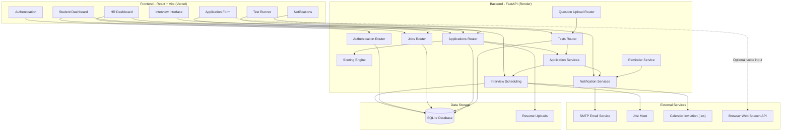
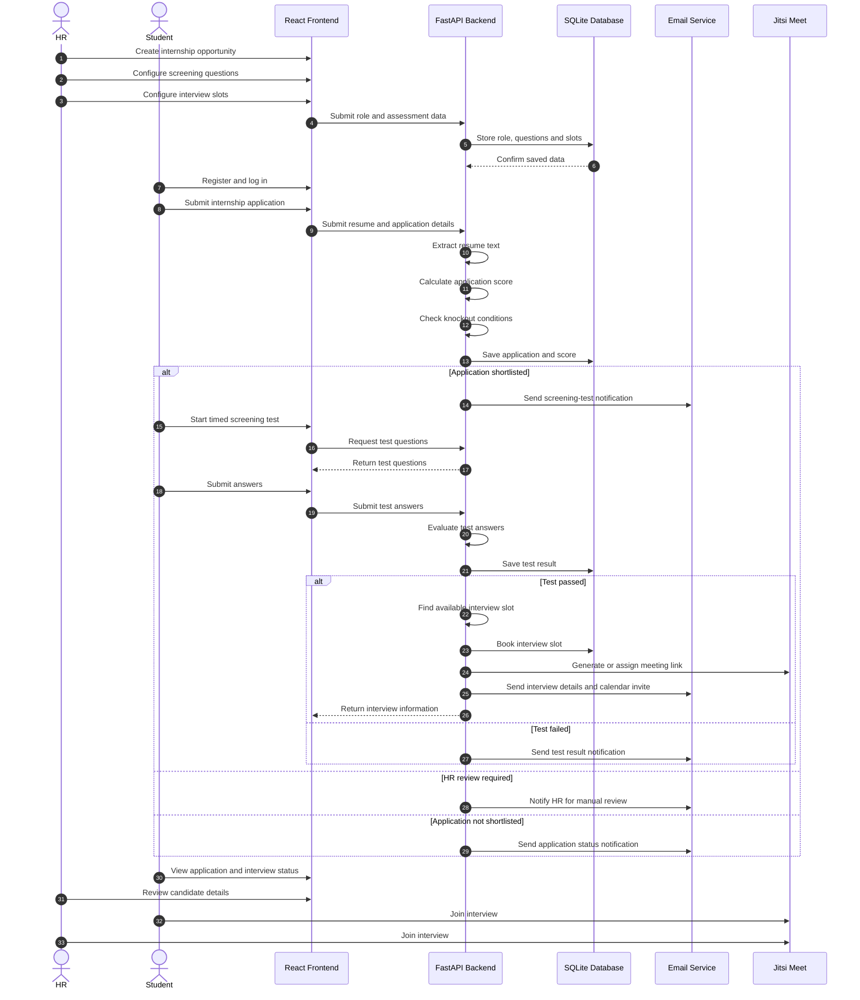
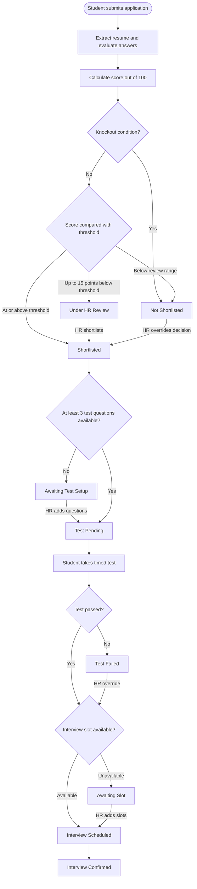
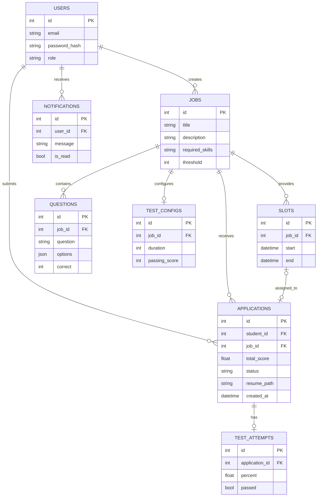
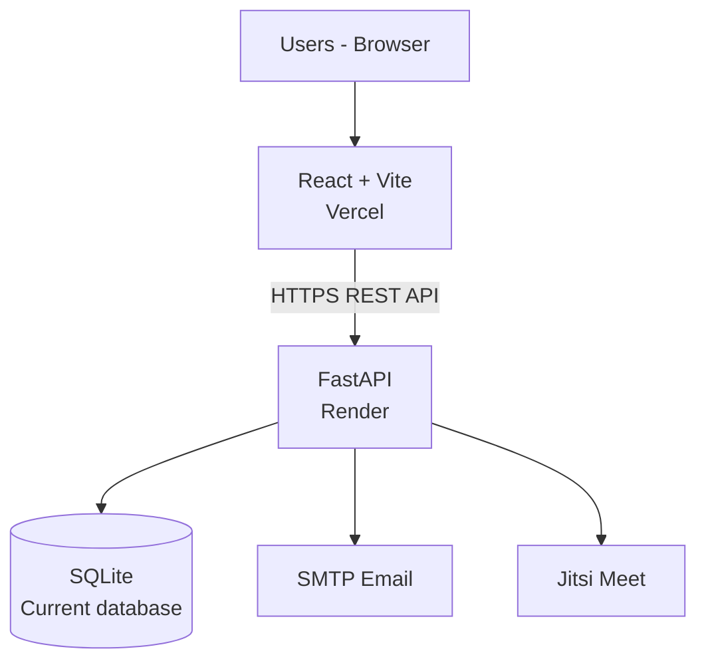

# Hr_Evaluator


[](https://akshara-hiring.vercel.app)
[](https://hr-evaluator-api.onrender.com/docs)


**Hr_Evaluator** is an online internship recruitment and evaluation platform with separate student and HR dashboards. Students can discover opportunities, submit applications, and take timed screening tests. HR users can publish opportunities, manage assessments, review candidates, and schedule interviews.

The platform evaluates applications using a rule-based scoring engine, automatically processes screening-test results, and supports interview scheduling with Jitsi Meet links, email notifications, and calendar invitations.

---

## Live Demo

| Service | URL |
|---|---|
| Web application | https://akshara-hiring.vercel.app |
| Backend API | https://hr-evaluator-api.onrender.com |
| Swagger API documentation | https://hr-evaluator-api.onrender.com/docs |
| Health check | https://hr-evaluator-api.onrender.com/api/health |

> **Deployment note:** The backend is hosted on Render. If using a free instance, it may sleep after inactivity, resulting in a delay on the first request. SQLite and local file uploads should be treated as demonstration storage unless persistent storage and backups have been configured.

### Try the application

1. Open the web application.
2. Register a new account with the **Student** role.
3. Browse available internship opportunities and submit an application.
4. To access the HR dashboard, register using the **HR** role and the private signup code.
5. Use the HR dashboard to create opportunities, configure screening tests, and manage applicants.

---

## Table of Contents

- [Features](#features)
- [System Architecture](#system-architecture)
- [End-to-End Workflow](#end-to-end-workflow)
- [Application Status Flow](#application-status-flow)
- [Database Design](#database-design)
- [Application Scoring](#application-scoring)
- [Technology Stack](#technology-stack)
- [Project Structure](#project-structure)
- [Installation and Setup](#installation-and-setup)
- [Environment Variables](#environment-variables)
- [Deployment](#deployment)
- [Test Question Format](#test-question-format)
- [API Overview](#api-overview)
- [Security Considerations](#security-considerations)
- [Known Limitations](#known-limitations)
- [Future Improvements](#future-improvements)
- [Contributing](#contributing)

---

## Features

### Student Features

- Student registration and authentication.
- Browse available internship opportunities.
- View role descriptions, required skills, location, stipend, and duration.
- Apply for opportunities with resume uploads.
- Submit skills, education details, and screening answers.
- Optional voice input using the browser Web Speech API.
- View application scores and application status.
- Take timed multiple-choice screening tests.
- View test results.
- Receive interview scheduling notifications.
- Confirm interview attendance.
- Access interview meeting links.
- Receive email notifications and calendar invitations.

### HR Features

- HR registration protected by a private signup code.
- Create, update, and manage internship opportunities.
- Define required skills and application evaluation thresholds.
- Configure internship details such as location, stipend, and duration.
- Upload screening questions using PDF, TXT, or CSV files.
- Add screening questions manually.
- Review candidate applications and evaluation scores.
- Shortlist or reject candidates manually.
- Configure interview availability slots.
- Automatically schedule eligible candidates into available slots.
- View candidate application and test results.
- Receive notifications about candidate activity.

### Automated Features

- Rule-based resume and skills evaluation.
- Screening-answer evaluation.
- Knockout-condition checking.
- Automatic application status updates.
- Server-side test evaluation.
- Interview slot allocation.
- Email notifications.
- Calendar invitations using `.ics` files.
- Interview reminders.

---

## System Architecture

The application follows a frontend-backend architecture. The React frontend communicates with the FastAPI backend through REST API endpoints.



### Architecture Components

| Component | Responsibility |
|---|---|
| React + Vite | Frontend interface and dashboards |
| FastAPI | REST API and backend business logic |
| SQLAlchemy | Database ORM and persistence |
| SQLite | Application data storage |
| Scoring Engine | Rule-based application evaluation |
| PDF/TXT/CSV Parser | Extract screening questions and resume text |
| SMTP | Email notifications |
| Jitsi Meet | Interview meeting links |
| `.ics` | Calendar invitations |
| Web Speech API | Optional browser-based voice input |

---

## End-to-End Workflow

The following sequence describes the main recruitment workflow.



---

## Application Status Flow

The following diagram represents the application's evaluation and interview progression.



> The exact transition rules and status names should be kept consistent with the backend implementation.

---

## Database Design

The application uses SQLAlchemy models to manage users, opportunities, applications, tests, interview slots, and notifications.

The following diagram is a conceptual representation of the database relationships.



> This is a logical overview, not a guarantee that every displayed field or relationship exactly matches the current SQLAlchemy models. Refer to `backend/app/models.py` for the authoritative schema.

---

## Application Scoring

Hr_Evaluator currently uses a **rule-based scoring engine**, not an external AI or LLM API.

Each application is evaluated using a score out of 100.

| Evaluation Category | Maximum Points | Evaluation |
|---|---:|---|
| Skill Match | 35 | Required skills found in resume and submitted skills |
| Resume Quality | 15 | Resume length and relevant keywords |
| Introduction and Experience | 24 | Screening answers, experience and skill relevance |
| Hours, Stipend and Location | 14 | Candidate's stated preferences and eligibility |
| Commitment and NOC | 12 | Commitment duration and approval availability |
| **Total** | **100** | **Rule-based evaluation** |

### Knockout Conditions

An application can be rejected regardless of its numerical score if the candidate does not satisfy mandatory requirements.

Examples include:

- Candidate is not comfortable with the required working hours or stipend.
- Candidate is not comfortable with the location, unless the opportunity is remote.
- Candidate's committed duration is shorter than the internship duration.

### Evaluation Outcomes

| Condition | Outcome |
|---|---|
| Score meets or exceeds the configured threshold | Shortlisted |
| Score is within 15 points below the threshold | Under HR Review |
| Score is below the review range | Not Shortlisted |
| Mandatory knockout condition is triggered | Not Shortlisted |

HR users can manually review and override application decisions where supported by the application.

---

## Technology Stack

| Layer | Technology | Purpose |
|---|---|---|
| Frontend | React 18 | User interface |
| Build Tool | Vite | Frontend development and build |
| Styling | CSS | Application styling |
| Backend | Python 3.12 | Backend programming language |
| API Framework | FastAPI | REST API |
| ORM | SQLAlchemy | Database interaction |
| Server | Uvicorn | ASGI application server |
| Database | SQLite | Local application database |
| PDF Processing | pypdf | Resume and question extraction |
| Email | SMTP | Email notifications |
| Calendar | iCalendar `.ics` | Interview calendar invitations |
| Video Meetings | Jitsi Meet | Interview meeting links |
| Voice Input | Web Speech API | Optional browser voice input |
| Frontend Hosting | Vercel | Frontend deployment |
| Backend Hosting | Render | Backend deployment |

---

## Project Structure

```text
Hr_System/
│
├── backend/
│   ├── app/
│   │   ├── main.py
│   │   ├── database.py
│   │   ├── models.py
│   │   ├── schemas.py
│   │   ├── security.py
│   │   ├── scoring.py
│   │   ├── services.py
│   │   ├── questions.py
│   │   ├── email_service.py
│   │   ├── qparse.py
│   │   │
│   │   └── routers/
│   │       ├── auth.py
│   │       ├── jobs.py
│   │       ├── applications.py
│   │       ├── notifications.py
│   │       ├── tests.py
│   │       └── qupload.py
│   │
│   ├── uploads/
│   ├── requirements.txt
│   ├── .env.example
│   └── hr.db
│
├── frontend/
│   ├── public/
│   ├── src/
│   │   ├── components/
│   │   │   ├── Auth.jsx
│   │   │   ├── StudentDashboard.jsx
│   │   │   ├── HrDashboard.jsx
│   │   │   ├── ApplyForm.jsx
│   │   │   ├── TestManager.jsx
│   │   │   ├── TestRunner.jsx
│   │   │   └── Notifications.jsx
│   │   │
│   │   ├── main.jsx
│   │   ├── App.jsx
│   │   ├── api.js
│   │   ├── ui.js
│   │   └── styles.css
│   │
│   ├── index.html
│   ├── package.json
│   └── vite.config.js
│
├── .gitignore
└── README.md
```

---

## Installation and Setup

### Prerequisites

Install the following before running the project:

- Python 3.12 or later.
- Node.js and npm.
- Git.
- A code editor such as Visual Studio Code.

### 1. Clone the repository

```bash
git clone https://github.com/Mysteriousboy727/Hr_Evaluator.git

cd Hr_Evaluator
```

### 2. Backend Setup

Open a terminal inside the project directory.

```powershell
cd backend
```

Create a Python virtual environment:

```powershell
python -m venv venv
```

Activate the virtual environment:

```powershell
.\venv\Scripts\Activate.ps1
```

Install backend dependencies:

```powershell
pip install -r requirements.txt
```

Create the environment file:

```powershell
Copy-Item .env.example .env
```

Update the `.env` file with your local configuration.

Start the FastAPI server:

```powershell
uvicorn app.main:app --reload
```

Backend server:

```text
http://127.0.0.1:8000
```

Swagger documentation:

```text
http://127.0.0.1:8000/docs
```

### 3. Frontend Setup

Open another terminal:

```powershell
cd frontend
```

Install dependencies:

```powershell
npm install
```

Start the Vite development server:

```powershell
npm run dev
```

Frontend application:

```text
http://localhost:5173
```

### 4. Run Both Applications

Keep the backend and frontend terminals running simultaneously.

| Service | Local URL |
|---|---|
| React frontend | http://localhost:5173 |
| FastAPI backend | http://127.0.0.1:8000 |
| Swagger documentation | http://127.0.0.1:8000/docs |

---

## Environment Variables

Create a `.env` file inside the `backend/` directory.

Example:

```env
# HR registration protection
HR_SIGNUP_CODE=your_private_signup_code

# SMTP configuration
SMTP_HOST=smtp.gmail.com
SMTP_PORT=587
SMTP_USER=your_email@gmail.com
SMTP_PASSWORD=your_app_password
FROM_EMAIL=your_email@gmail.com

# Add other variables required by your backend here.
```

### Environment Variable Description

| Variable | Description |
|---|---|
| `HR_SIGNUP_CODE` | Private code required for HR registration |
| `SMTP_HOST` | SMTP server hostname |
| `SMTP_PORT` | SMTP server port |
| `SMTP_USER` | SMTP account username |
| `SMTP_PASSWORD` | SMTP password or application password |
| `FROM_EMAIL` | Sender email address |

> Never commit your `.env` file, SMTP credentials, database files, or private signup code to GitHub. Keep `.env.example` in the repository with placeholder values only.

---

## Deployment

The current application uses the following hosting arrangement:



### Frontend Deployment - Vercel

1. Push the project to GitHub.
2. Open Vercel.
3. Import the GitHub repository.
4. Set the root directory to `frontend`.
5. Select Vite as the framework.
6. Configure the build command:

```bash
npm run build
```

7. Configure the output directory:

```text
dist
```

8. Add the backend API URL as a frontend environment variable if the frontend uses it:

```env
VITE_API_BASE_URL=https://hr-evaluator-api.onrender.com
```

9. Deploy the application.

Ensure `frontend/src/api.js` actually reads `import.meta.env.VITE_API_BASE_URL` and constructs API requests using that value.

### Backend Deployment - Render

1. Open Render.
2. Create a new Web Service.
3. Connect the GitHub repository.
4. Set the root directory to `backend`.
5. Configure the build command:

```bash
pip install -r requirements.txt
```

6. Configure the start command:

```bash
uvicorn app.main:app --host 0.0.0.0 --port $PORT
```

7. Add the required environment variables in Render.
8. Deploy the backend.

### Important Production Database Note

The current project uses SQLite (`hr.db`). A local SQLite database or upload directory on an ephemeral hosting filesystem should not be treated as durable production storage.

For a production deployment, plan to migrate to:

- Managed PostgreSQL for application data.
- Private object storage, such as Amazon S3, for uploaded resumes.
- Database backups and a migration strategy.
- HTTPS and restricted CORS configuration.

Adding a PostgreSQL connection string alone does not migrate existing SQLite records. The database models, connection configuration, driver, schema, and existing data must be handled as part of the migration.

### Deployment URLs

```text
Frontend:
https://akshara-hiring.vercel.app

Backend:
https://hr-evaluator-api.onrender.com

Swagger:
https://hr-evaluator-api.onrender.com/docs
```

---

## Test Question Format

The platform supports screening-question uploads in the formats implemented by the question parser.

### Example CSV

```csv
question,option_a,option_b,option_c,option_d,correct_answer
What is Python?,Programming Language,Database,Operating System,Browser,A
Which data structure uses FIFO?,Stack,Queue,Tree,Graph,B
What does SQL stand for?,Structured Query Language,Simple Query Language,System Query Language,Sequential Query Language,A
```

### Example TXT

```text
Q: What is Python?
A: Programming Language
B: Database
C: Operating System
D: Browser
Answer: A

Q: Which data structure uses FIFO?
A: Stack
B: Queue
C: Tree
D: Graph
Answer: B
```

> The exact CSV column names and TXT parsing rules must match the implementation in `backend/app/qparse.py`. Check that file before preparing bulk uploads.

---

## API Overview

The backend exposes REST endpoints through FastAPI.

The following is a high-level overview of the application's API routes.

### Authentication

| Method | Endpoint | Description |
|---|---|---|
| POST | `/api/auth/register` | Register a student or HR account |
| POST | `/api/auth/login` | Authenticate a user |
| GET | `/api/auth/me` | Get the authenticated user |

### Jobs

| Method | Endpoint | Description |
|---|---|---|
| GET | `/api/jobs` | Retrieve available jobs |
| POST | `/api/jobs` | Create a job |
| GET | `/api/jobs/{id}` | Retrieve job details, if implemented |
| PUT/PATCH | `/api/jobs/{id}` | Update a job, if implemented |

### Applications

| Method | Endpoint | Description |
|---|---|---|
| POST | `/api/jobs/{id}/apply` | Submit an application |
| GET | `/api/my/applications` | Retrieve the student's applications |
| GET | `/api/jobs/{id}/applications` | Retrieve applications for a job |
| POST | `/api/applications/{id}/decision` | Update an application decision |
| POST | `/api/applications/{id}/confirm` | Confirm an application or interview, as implemented |

### Screening Tests

| Method | Endpoint | Description |
|---|---|---|
| GET | `/api/jobs/{id}/test` | Retrieve test configuration |
| GET | `/api/jobs/{id}/test/questions` | Retrieve test questions |
| POST | `/api/jobs/{id}/test/upload-file` | Upload test questions |
| POST | `/api/applications/{id}/test/start` | Start a screening test |
| POST | `/api/applications/{id}/test/submit` | Submit test answers |

### Notifications

| Method | Endpoint | Description |
|---|---|---|
| GET | `/api/notifications` | Retrieve notifications |
| POST | `/api/notifications/read` | Mark notifications as read |

### API Documentation

Explore the interactive Swagger documentation:

https://hr-evaluator-api.onrender.com/docs

> The route list is an overview based on the documented application endpoints. The running FastAPI application and its Swagger schema are the source of truth for supported methods, request bodies, and response formats.

---

## Security Considerations

For a production deployment, the following practices should be followed:

- Store passwords as secure password hashes.
- Keep authentication secrets and credentials in environment variables.
- Never expose SMTP credentials or HR signup codes in frontend code.
- Validate uploaded resume and question files.
- Restrict upload file types and file sizes.
- Protect HR-only endpoints with role-based authorization.
- Ensure students can access only their own applications and results.
- Avoid exposing correct test answers before submission.
- Validate test duration and submission deadlines on the server.
- Use HTTPS for all production traffic.
- Configure CORS to allow only trusted frontend origins.
- Store resumes in private storage and restrict access to authorized users.
- Back up the production database regularly.
- Define a retention policy for resumes and candidate information.

---

## Known Limitations

- Application scoring is rule-based and does not use an AI model.
- Resume evaluation depends on extracted text and configured keywords.
- SQLite is suitable for local development and demonstrations, but managed database storage is preferable for production.
- Local file uploads require persistent storage or migration to object storage in a production environment.
- Jitsi meeting links provide video-call access; they do not represent a custom-built video conferencing infrastructure.
- Browser voice input depends on browser support and user permissions.
- Email delivery depends on valid SMTP configuration.
- Render free instances may experience cold starts after inactivity.
- Automated interview scheduling depends on the availability of configured HR slots.

---

## Future Improvements

- Migrate from SQLite to PostgreSQL.
- Move resume storage to private cloud object storage.
- Integrate an embedded video interview SDK.
- Add secure interview-room access and participant authentication.
- Introduce AI-assisted resume analysis with explainable scoring.
- Add advanced candidate filtering and analytics.
- Add interview feedback and evaluation forms.
- Implement automated interview reminders and scheduling improvements.
- Add comprehensive audit logs.
- Add automated backend and frontend tests.
- Implement CI/CD workflows using GitHub Actions.
- Add monitoring, logging, and error tracking.

---

## Contributing

Contributions, suggestions, and improvements are welcome.

1. Fork the repository.
2. Create a feature branch.
3. Make your changes.
4. Test your changes locally.
5. Submit a pull request.

```bash
git checkout -b feature/your-feature-name

git add .

git commit -m "Add: your feature description"

git push origin feature/your-feature-name
```

---

## Author

**Hr_Evaluator**

An internship recruitment and evaluation platform built with React, FastAPI, and SQLAlchemy.

**Repository:**  
https://github.com/Mysteriousboy727/Hr_Evaluator

---

<p align="center">
  Built to simplify internship recruitment, candidate evaluation, and interview scheduling.
</p>
